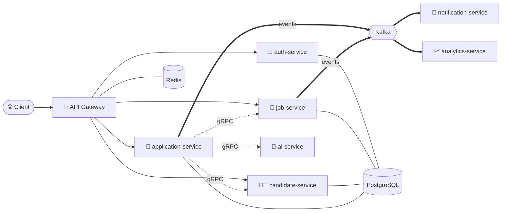

<div align="center">


<a href="https://github.com/nilesh24rit/HireFlow">
  
</a>

<br/>


</div>

---

## 📌 Table of Contents

- [✨ About HireFlow](#-about-hireflow)
- [🚀 Features](#-features)
- [🏗️ Architecture](#️-architecture)
- [🧩 Services](#-services)
- [🛠️ Tech Stack](#️-tech-stack)
- [📂 Project Structure](#-project-structure)
- [⚡ Getting Started](#-getting-started)
- [🧠 `./about-me.java`](#-about-mejava)
- [🛠️ Arsenal](#️-arsenal)
- [🔥 Featured Projects](#-featured-projects)
- [📊 Stats](#-stats-aka-proof-i-touch-grass-er-keyboards)
- [🎯 Currently](#-currently)
- [🤝 Let's connect](#-lets-connect)
- [📄 License](#-license)

---

## ✨ About HireFlow

**HireFlow** is a backend-first, **microservices-based hiring platform** that models the complete recruitment lifecycle - from posting a job, to candidates applying, to AI-assisted screening, analytics and real-time notifications.

Every capability lives in its own independently deployable service. Services talk to each other through **gRPC** (synchronous, contract-first with Protobuf) and **Kafka** (asynchronous, event-driven), all behind a single **API Gateway**.

> 💡 Built to practise what production systems actually look like: service boundaries, contracts, events, caching, containers.

---

## 🚀 Features

| | Feature | Description |
|---|---|---|
| 🔐 | **Authentication & Authorization** | Secure login, token-based access and role handling via a dedicated auth service |
| 💼 | **Job Management** | Create, update, publish and search job postings |
| 🧑‍💻 | **Candidate Profiles** | Manage candidate information and profiles |
| 📝 | **Application Tracking** | Candidates apply to jobs; track each application through the hiring pipeline |
| 🤖 | **AI Assistance** | Dedicated AI service for smart screening / matching |
| 📈 | **Analytics** | Event-driven analytics on jobs, applications and funnel metrics |
| 🔔 | **Notifications** | Async notifications triggered by hiring events |
| 🚪 | **Single Entry Point** | API Gateway for routing and cross-cutting concerns |
| 📜 | **Contract-first APIs** | Shared Protobuf / gRPC contracts across services |
| 🌱 | **Dev Seed Data** | Ready-made seed data for quick local development |

---

## 🏗️ Architecture



> ℹ️ The diagram shows the intended service topology. Adjust the arrows if your actual wiring differs.

---

## 🧩 Services

| Service | Responsibility |
|---|---|
| 🚪 [`api-gateway`](./api-gateway) | Single entry point - routing, filtering and cross-cutting concerns |
| 🔐 [`auth-service`](./auth-service) | Authentication, authorization and user identity |
| 💼 [`job-service`](./job-service) | Job postings lifecycle |
| 🧑‍💻 [`candidate-service`](./candidate-service) | Candidate profiles and data |
| 📝 [`application-service`](./application-service) | Job applications and hiring pipeline stages |
| 🤖 [`ai-service`](./ai-service) | AI-powered screening and matching |
| 📈 [`analytics-service`](./analytics-service) | Consumes events and produces hiring analytics |
| 🔔 [`notification-service`](./notification-service) | Sends notifications on hiring events |
| 📜 [`proto`](./proto) | Protobuf definitions |
| 🔗 [`grpc-contracts`](./grpc-contracts) | Shared generated gRPC contracts |
| 🌱 [`dev-seed`](./dev-seed) | Seed data / scripts for local development |

---

## 🛠️ Tech Stack

| Layer | Technologies |
|---|---|
| **Language & Framework** | `Java` `Spring Boot` `REST APIs` |
| **Inter-service communication** | `gRPC` `Protobuf` `Kafka` |
| **Data & Caching** | `PostgreSQL` `Redis` |
| **Infra & DevOps** | `Docker` `Git` `GitHub Actions` |
| **Observability** | `Prometheus` `Grafana` |

---

## 📂 Project Structure

```text
HireFlow/
├── 🚪 api-gateway/            # Entry point & routing
├── 🔐 auth-service/           # Authentication & authorization
├── 💼 job-service/            # Job postings
├── 🧑‍💻 candidate-service/      # Candidate profiles
├── 📝 application-service/    # Applications & pipeline
├── 🤖 ai-service/             # AI screening / matching
├── 📈 analytics-service/      # Analytics (event consumer)
├── 🔔 notification-service/   # Notifications
├── 📜 proto/                  # .proto definitions
├── 🔗 grpc-contracts/         # Shared gRPC contracts
├── 🌱 dev-seed/               # Local dev seed data
├── LICENSE                    # Apache-2.0
└── README.md
```

---

## ⚡ Getting Started

### Prerequisites

- ☕ Java 17+
- 🐳 Docker & Docker Compose
- 📦 Maven / Gradle (as used by each service)
- 🐘 PostgreSQL, 🔴 Redis, 📨 Kafka (run via Docker)

### Run locally

```bash
# 1. Clone the repository
git clone https://github.com/nilesh24rit/HireFlow.git
cd HireFlow

# 2. Start infrastructure (PostgreSQL, Redis, Kafka)
docker compose up -d

# 3. Start each service (example)
cd auth-service && ./mvnw spring-boot:run

# 4. (Optional) Load development seed data
#    see ./dev-seed for scripts
```

> 🔧 Replace the commands above with your exact setup (compose file, ports, env variables) as the project evolves.

---

<div align="center">

# 👨‍💻 About the Author

</div>

<div align="center">

[](https://github.com/nilesh24rit)

[](https://github.com/nilesh24rit)

[](https://github.com/nilesh24rit)

| [](https://github.com/nilesh24rit) | [](https://github.com/nilesh24rit) |
|---|---|

</div>

---

## 🧠 `./about-me.java`

```java
public class Nilesh {

    String name      = "Nilesh Kumar Singh";
    String college   = "M. S. Ramaiah Institute of Technology, Bengaluru";
    String degree    = "B.Tech CSE (pre-final year)";
    String superpower = "Making backends scale (and Dockerfiles stop crying)";

    String[] stack = {
        "Java", "Spring Boot", "REST APIs", "Microservices",
        "PostgreSQL", "Redis", "Kafka", "gRPC", "Docker"
    };

    String currentlyHunting = "Backend SWE internships 🎯";
    String longTermQuest    = "Ship code in Japan 🇯🇵";
    String funFact          = "I read stack traces for fun. Mostly out of necessity.";

    public void run() {
        while (alive) {
            eat(); sleep(); code(); deploy(); debug(); repeat();
        }
    }
}
```

---

## 🛠️ Arsenal

<div align="center">

[](https://skillicons.dev)

</div>

---

## 🔥 Featured Projects

| Project | What it does | Stack |
|---|---|---|
| 🛒 [**CommerceX**](https://github.com/nilesh24rit/E-Commerce) | Production-style e-commerce backend, live on Render, with monitoring dashboards | `Spring Boot` `PostgreSQL` `Redis` `Prometheus` `Grafana` |
| 🏥 [**Patient-Manager**](https://github.com/nilesh24rit/Patient-Manager) | Microservices system: patient, billing (gRPC), analytics (Kafka + Protobuf) behind an API gateway | `Spring Cloud Gateway` `gRPC` `Kafka` `Docker` |
| 🛡️ [**CacheGuard**](https://github.com/nilesh24rit/CacheGuard) | Redis-powered rate limiting for Spring Boot apps | `Spring Boot` `Redis` |
| 📓 [**JournalApp**](https://github.com/nilesh24rit/JournalApp) | Secure journaling backend with sessions, Kafka events and cloud-hosted DBs | `Spring Security` `MongoDB` `Redis` `Kafka` |
| 🧮 [**dsa-toolkit-java**](https://github.com/nilesh24rit/dsa-toolkit-java) | Modular DSA library: graph algorithms, sorting, self-balancing trees | `Java` `DSA` |

---

## 📊 Stats (a.k.a. proof I touch grass... er, keyboards)

<div align="center">

[](https://github.com/nilesh24rit)
[](https://github.com/nilesh24rit)

[](https://github.com/nilesh24rit)

</div>

---

## 🎯 Currently

- 🔭 Building & breaking **microservices** (and fixing them at 2 AM)
- 🧗 Grinding **DSA** alongside backend projects
- 📬 Open to **backend software engineering internships**
- 🇯🇵 Long-term goal: working in the **Japanese tech scene**

---

## 🤝 Let's connect

<div align="center">

[](https://github.com/nilesh24rit)

*"It works on my machine" - me, right before Docker humbled me. 🐳*

</div>

---

## 📄 License

This project is licensed under the **Apache License 2.0** - see the [LICENSE](./LICENSE) file for details.

<div align="center">

⭐ **If you like HireFlow, drop a star - it keeps the Kafka topics flowing!** ⭐


</div>
